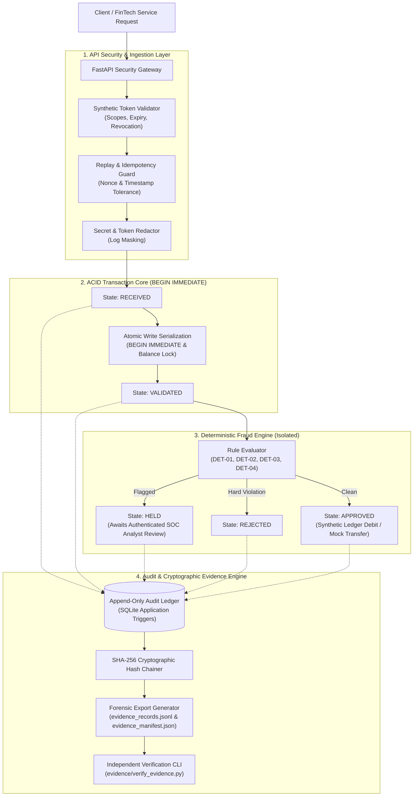

# PAYGUARD SOC: Synthetic Architecture & Security Specification

> **Lab Notice**: This environment is entirely **local and synthetic**. All currency values are modeled in **Indian Rupees (INR / ₹)**. No real-world money transfers, external payment gateways, or banking networks (SWIFT, NPCI, card networks) are contacted. All thresholds are configurable synthetic training parameters.

---

## 1. System Overview

PAYGUARD SOC is a simulated FinTech micro-disbursement processing engine and Security Operations Center (SOC) defense lab. It demonstrates production-grade transaction integrity, API defense-in-depth, deterministic fraud detection, and tamper-evident forensic auditing.



---

## 2. Transaction Integrity & Concurrency Architecture

### 2.1 Explicit 5-State Finite State Machine (FSM)
Every transaction must traverse deterministic states. State transitions are strictly validated and recorded in the audit trail:

1. **`RECEIVED`**: Ingested via API gateway; Nonce, Timestamp, and Idempotency key verified; initial audit event recorded.
2. **`VALIDATED`**: Loan account status (`APPROVED`), borrower ownership, and beneficiary linkage verified; sufficient approved balance confirmed.
3. **`HELD`**: Flagged by deterministic fraud rules (e.g. micro-probe or velocity anomaly); transaction paused pending manual SOC analyst intervention.
4. **`REJECTED`**: Hard policy violation (unapproved loan, inactive beneficiary, balance exhaustion, or analyst rejection); terminal state.
5. **`APPROVED`**: All security, loan limit, and fraud checks cleared (or analyst override approved); loan balance atomically debited; internal synthetic ledger credited.

### 2.2 SQLite Concurrency & Write Serialization via `BEGIN IMMEDIATE`
- **Concurrency Problem**: SQLite in WAL mode permits concurrent readers, but serializes writers. Under default deferred transactions (`BEGIN DEFERRED`), multiple connections start with a shared read lock. When they concurrently attempt to write, each tries to upgrade to a reserved lock, resulting in lock-upgrade deadlocks (`sqlite3.OperationalError: database is locked`).
- **PAYGUARD Solution**:
  1. All state mutations and balance evaluations execute exclusively within `BEGIN IMMEDIATE` transaction blocks.
  2. `BEGIN IMMEDIATE` acquires a reserved write lock at transaction start, preventing conflicting writers from entering the critical section while WAL readers proceed.
  3. `PRAGMA busy_timeout = 5000;` gives concurrent workers a 5-second queue window to serialize cleanly.
  4. Balance checks utilize atomic conditional SQL:
     ```sql
     UPDATE loans 
     SET disbursed_amount_inr = disbursed_amount_inr + :amount,
         updated_at = :timestamp
     WHERE loan_id = :loan_id 
       AND (disbursed_amount_inr + :amount) <= approved_limit_inr;
     ```
     If `cur.rowcount == 0`, the transaction is immediately rejected with reason `INSUFFICIENT_APPROVED_LOAN_BALANCE`.

### 2.3 Idempotency Controls
- `idempotency_records` table indexes `(idempotency_key, client_id, request_hash)`.
- If a request with an existing idempotency key is received:
  - **Identical Hash**: Returns the cached response with the original transaction ID without re-executing or double-debiting.
  - **Payload Tampering**: If the amount, borrower, or beneficiary differs, raises `409 Conflict` (`IDEMPOTENCY_PAYLOAD_MISMATCH`).

---

## 3. API Security & Environment Restrictions

### 3.1 Synthetic Token Lifecycle & Granular Scopes
- Synthetic tokens are managed in an in-memory/database registry with explicit expiration (`expires_at`) and revocation (`is_revoked`) flags.
- **Endpoint-Specific Scopes**:
  - `disbursement:create` — Initiate disbursements.
  - `disbursement:read` — Read transaction status.
  - `soc:review` — Authenticated SOC analyst review of `HELD` transactions.
  - `audit:export` — Export forensic evidence manifests.
- Missing, expired, or revoked tokens return HTTP 401 with explicit security error codes.

### 3.2 Request Timestamping & Single-Use Nonces
- Header `X-Timestamp`: Rejects requests where $|\text{now} - \text{timestamp}| > 300\text{s}$ (`SECURITY_TIMESTAMP_SKEWED`).
- Header `X-Nonce`: Single-use random token registered in `used_nonces`. Duplicate nonces from the same client are rejected (`SECURITY_REPLAY_DETECTED`).

### 3.3 Log Masking & Zero-Trust Network Policy
- Logging handlers apply `SecretRedactorFilter` to scrub tokens matching `lab_tok_[a-zA-Z0-9_-]+` into `lab_tok_***[REDACTED]***`.
- Client IP is recorded strictly as contextual forensic telemetry, **never** as the primary authorization mechanism.

### 3.4 Socket-Level Network Isolation
Network isolation is enforced at the Python socket layer (`backend/network_isolation.py`). Any outbound connection attempt to non-local addresses raises `RuntimeError("NETWORK_ISOLATION_VIOLATION...")`, mathematically preventing connections to external payment gateways or internet services.

---

## 4. Deterministic Fraud Detection Engine

The fraud detection subsystem is completely decoupled from any statistical/ML components:

| Rule Code | Threat Vector | Synthetic Lab Thresholds (INR) | Enforcement Action |
| :--- | :--- | :--- | :--- |
| **`DET-01`** | **Micro-Value to High-Value Probe**: Testing account validity with small transfer before draining. | $\text{Micro} \le ₹50.00$, $\text{High} \ge ₹5,000.00$, Window $\le 300\text{s}$. | Transition to `HELD` (`FRAUD_PROBE_MICRO_HIGH_VALUE`). |
| **`DET-02`** | **New Beneficiary Velocity Spike**: Rapid burst transfers to an unseen recipient. | Unseen beneficiary + $\ge 3$ transactions in $60\text{s}$. | Transition to `HELD` (`FRAUD_UNSEEN_BENEFICIARY_VELOCITY`). |
| **`DET-03`** | **Unapproved / Closed Loan Reference**: Disbursement without active approved facility. | Loan status $\ne \text{'APPROVED'}$. | Transition to `REJECTED` (`INVALID_OR_UNAPPROVED_LOAN_STATUS`). |
| **`DET-04`** | **Authentication Brute Force / Token Misuse**: Repeated token errors. | $\ge 3$ auth failures within $60\text{s}$. | Block caller with `SECURITY_AUTH_ABUSE_DETECTED`. |

### 4.1 SOC Analyst Review Workflow
Transactions placed into `HELD` state do not disburse funds. Clearing a held transaction requires an authenticated analyst call to `POST /api/v1/soc/transactions/{tx_id}/review`:
- **Required Header**: Synthetic token with `soc:review` scope.
- **Required Body**: `action` (`APPROVE` or `REJECT`), `analyst_id`, and `decision_reason` (min 10 characters).
- Transitions the transaction to `APPROVED` or `REJECTED`, debits the loan balance conditionally, and appends a signed audit event `ANALYST_HOLD_RESOLUTION`.

---

## 5. Audit, Forensic Evidence & Independent Verification

### 5.1 Application-Level Triggers vs. Forensic Immutability
- **Application-Level Defense**: SQLite triggers (`trg_audit_no_update`, `trg_audit_no_delete`) prevent SQL/ORM updates and deletions from the application.
- **Forensic Defensibility**: Because SQLite files on disk can theoretically be modified by raw disk edits, absolute forensic integrity is achieved cryptographically via **SHA-256 Hash Chaining**:
  $$H_n = \text{SHA-256}(H_{n-1} \,\|\, \text{event\_id} \,\|\, \text{timestamp} \,\|\, \text{action} \,\|\, \text{decision\_reason} \,\|\, \text{payload\_sha256})$$

### 5.2 Standalone Evidence Verifier (`evidence/verify_evidence.py`)
An independent CLI utility verifies exported evidence packages without requiring the API server or database:
```bash
python evidence/verify_evidence.py \
  --manifest evidence/evidence_manifest.json \
  --records evidence/evidence_records.jsonl
```
1. Validates the HMAC-SHA256 signature on `evidence_manifest.json`.
2. Sequentially re-hashes each record from genesis ($H_0 = 0^{64}$) to $H_N$.
3. Pinpoints the exact record index and event ID if tampering occurs.

---

## 6. Active Defense & Incident Response Engine

The `ResponseEngine` coordinate server-side defensive actions triggered by detection rules or executed manually by SOC analysts:

- **Actions Supported**:
  - `ALLOW`: Clean transaction progresses through FSM to `APPROVED`.
  - `HOLD`: Suspicious transaction paused in `HELD`; incident automatically registered in `soc_incidents`.
  - `REJECT`: Hard policy failure rejected at validation; loan balance unimpacted.
  - `BLOCK_SYNTHETIC_CALLER`: Registers offending `client_id` in `blocked_callers`; subsequent requests immediately rejected with HTTP 403 `SECURITY_CALLER_BLOCKED`.
  - `REVOKE_TOKEN`: Sets `is_revoked = 1` in `api_tokens`; token instantly invalidated across all gateways.
  - `ESCALATE_INVESTIGATION`: Opens or transitions incident status in `soc_incidents` (`OPEN` $\rightarrow$ `INVESTIGATING` $\rightarrow$ `CONTAINED` $\rightarrow$ `RESOLVED`).

---

## 7. Insecure Direct Object Reference (IDOR) Defense Architecture

To prevent cross-tenant data snooping across different micro-borrowers and lending partners:
1. `GET /api/v1/disbursements/{transaction_id}` inspects the authenticated token's scopes and client identity.
2. If token scopes include `soc:review`, `audit:export`, or client is identified as an auditor (`client_auditor_*`), access is granted for administrative inspection.
3. For standard lending partners and borrowers:
   - Verifies that `token_info.client_id == row["borrower_id"]` OR that the transaction's idempotency key was registered by this specific client in `idempotency_records`.
   - Any attempt to access a transaction outside client ownership is aborted with HTTP 403 Forbidden, and an audit event (`IDOR_ACCESS_BLOCKED`) is logged to the forensic chain.

